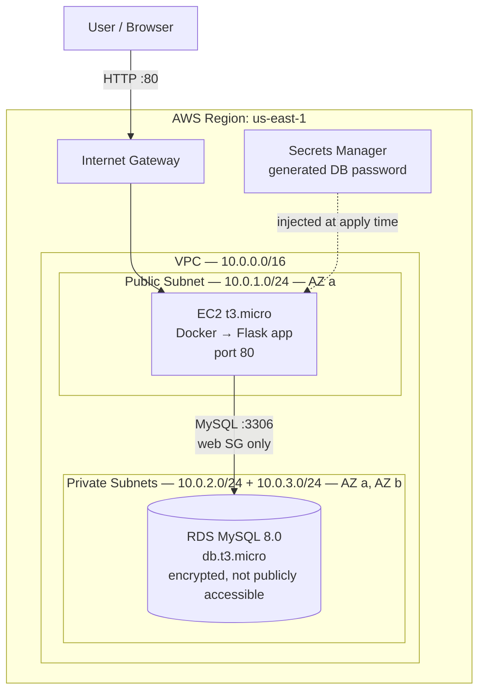
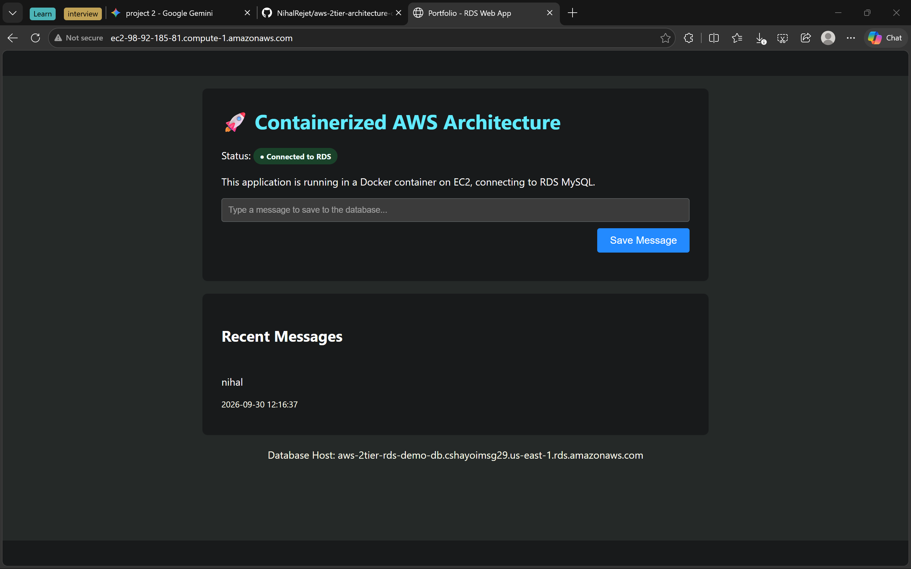
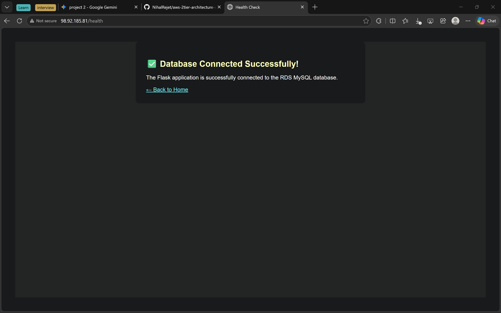

# AWS Two-Tier Architecture with Terraform

[](https://github.com/NihalRejet/aws-2tier-architecture-on-terraform/actions/workflows/terraform-ci.yml)

Terraform code that builds a classic two-tier web application on AWS: a public
web tier running a containerised Flask app, and a private data tier running
MySQL on RDS that cannot be reached from the internet.

Everything is written as reusable modules, the database password is generated
at apply time instead of being hardcoded, and every push is checked by CI.

---

## Architecture



**How the two tiers are kept apart**

- The public subnet has a route table pointing at the Internet Gateway, so the
  EC2 instance is reachable from outside.
- The private subnets are left on the VPC's main route table, which only has
  the `local` route. There is no path to the internet from them in either
  direction, so there is no NAT Gateway and no NAT Gateway bill.
- The database security group has no CIDR-based rule at all. Its only inbound
  rule references the **web security group**, so the database accepts traffic
  from the web tier and nothing else, even if the routing were wrong.
- Two private subnets exist because an RDS subnet group requires subnets in two
  availability zones. The database instance itself runs in one AZ.

---

## What gets created

| Module | Resources |
|---|---|
| `vpc` | VPC, 1 public subnet, 2 private subnets, Internet Gateway, public route table and association |
| `security_groups` | Web SG (HTTP from anywhere, SSH from a CIDR you choose) and DB SG (MySQL from the web SG only) |
| `secrets` | A 16-character random password and a Secrets Manager secret holding the credentials |
| `rds` | DB subnet group and a MySQL 8.0 instance, encrypted at rest, not publicly accessible |
| `ec2` | Ubuntu 22.04 instance that installs Docker, builds the Flask image and runs it on port 80 |

---

## Repository layout

```
.
├── main.tf                     # wires the modules together
├── variables.tf                # input variables and their defaults
├── outputs.tf                  # URLs, endpoints and IDs after apply
├── terraform.tfvars.example    # copy to terraform.tfvars and edit
├── modules/
│   ├── vpc/                    # network layer
│   ├── security_groups/        # firewall rules for both tiers
│   ├── secrets/                # password generation + Secrets Manager
│   ├── rds/                    # MySQL database
│   └── ec2/                    # web server
│       └── templates/
│           └── user_data.sh    # bootstraps Docker and the Flask app
└── .github/workflows/
    └── terraform-ci.yml        # validate + security scan on every push
```

---

## Prerequisites

- Terraform 1.0 or newer
- An AWS account and the AWS CLI configured (`aws configure`)
- IAM permissions to create VPC, EC2, RDS and Secrets Manager resources

---

## Deploying

```bash
# 1. Set your variables
cp terraform.tfvars.example terraform.tfvars

# 2. Restrict SSH to your own IP before applying
curl -s https://checkip.amazonaws.com        # note the address
# then set ssh_allowed_cidr = "YOUR.IP.ADDR/32" in terraform.tfvars

# 3. Deploy
terraform init
terraform plan
terraform apply
```

The database takes several minutes to come up, and the EC2 instance needs
another minute or two after that to install Docker and build the image. If the
page does not load straight away, give it a moment.

### Checking it worked

```bash
terraform output application_url     # open this in a browser
terraform output health_check_url    # returns 200 if the app reached the DB
```

If something goes wrong on the instance, the bootstrap log is written to
`/var/log/user-data.log` on the EC2 box.

### Tearing it down

```bash
terraform destroy
```

This removes everything, including the secret. Leaving the stack running costs
money, so destroy it when you are done.

---

## Cost

Most of the stack fits inside the AWS Free Tier for a new account: the
`t3.micro` instance, the `db.t3.micro` database and 20 GB of storage.

Two things to watch:

- **Secrets Manager is not in the free tier.** It charges a small amount per
  secret per month (around $0.40 at the time of writing — check the
  [current pricing](https://aws.amazon.com/secrets-manager/pricing/)). This repo
  sets the secret's recovery window to 0, so `terraform destroy` deletes it
  straight away instead of keeping it, and billing it, for another 30 days.
- Free Tier only applies for the first 12 months, and only to one instance of
  each type at a time.

---

## Security choices

What this code does:

- The database has no public IP and no route to the internet.
- The database security group trusts the web security group, not an IP range.
- The master password is generated by Terraform, never written in the repo, and
  stored in Secrets Manager.
- RDS storage and the EC2 root volume are both encrypted at rest.
- The instance requires IMDSv2, so instance metadata cannot be read through a
  simple server-side request forgery against the app.
- `*.tfvars` and `*.tfstate` are gitignored. State files hold secrets in
  plaintext, so they must never be committed.
- Message content is HTML-escaped before it is rendered.

### Known gaps

These are deliberate trade-offs for a demo, not oversights. They are the first
things that would change for a real deployment.

| Gap | Why it matters | What production would do |
|---|---|---|
| The password reaches the app through EC2 **user_data** | user_data is readable from instance metadata and visible in the EC2 console, so Secrets Manager is being used as storage rather than as the delivery path | Attach an IAM instance profile and have the app call `GetSecretValue` at startup |
| HTTP only, no TLS | Traffic and form data travel in clear text | An ALB with an ACM certificate, redirecting port 80 to 443 |
| Single instance, single AZ | Any instance or AZ failure takes the whole app down | ALB + Auto Scaling Group across AZs, and `multi_az = true` on RDS |
| No remote state backend | State lives on one laptop, with no locking | S3 bucket with versioning plus DynamoDB state locking |
| No VPC Flow Logs | No record of what connected to what | Flow Logs to CloudWatch or S3 |
| `skip_final_snapshot = true` | `destroy` throws the data away | Take a final snapshot and turn on deletion protection |

---

## Live application

The app writes to and reads from the RDS database, so the page proves the two
tiers are actually talking to each other.





---

## Built with

Terraform · AWS (VPC, EC2, RDS, Secrets Manager) · Docker · Python / Flask ·
MySQL · GitHub Actions · Trivy
